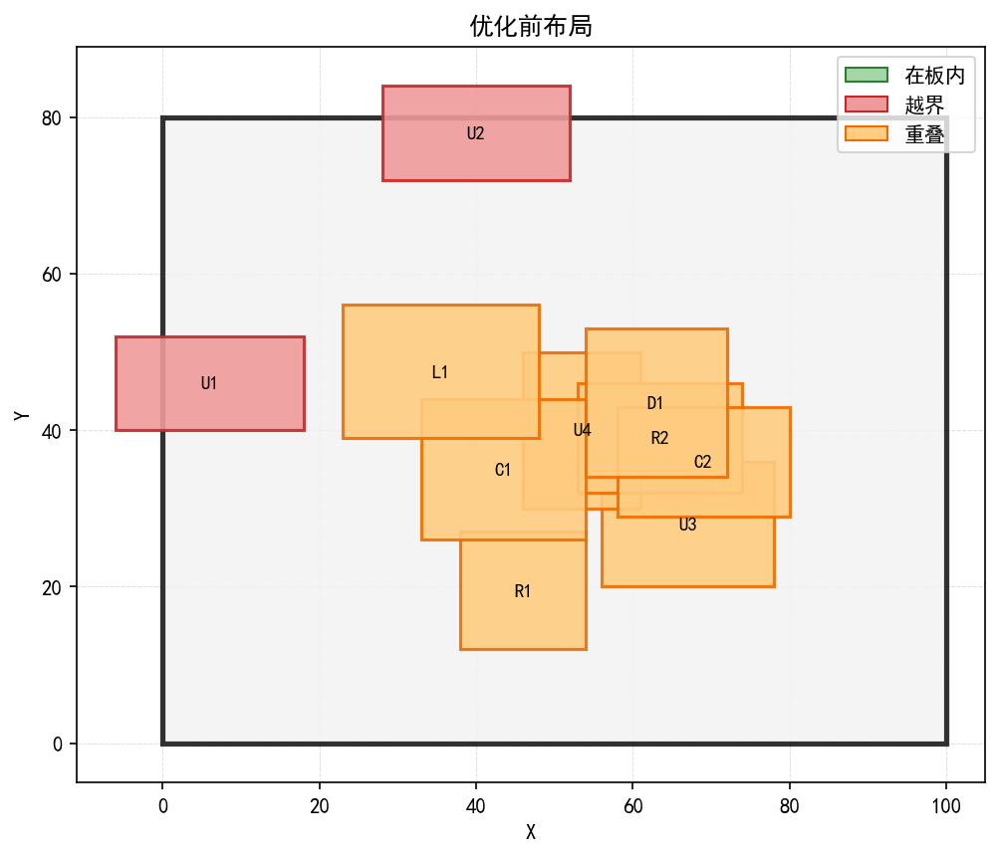
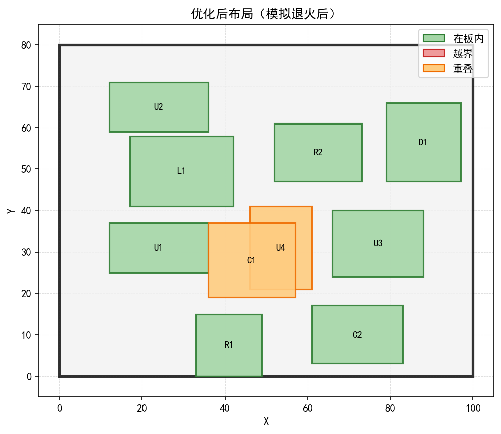

# pcb_sa_agent_demo

用自然语言驱动 PCB 布局优化的最小可用 Agent：**大模型负责判断「该调哪个工具、用什么参数」，Python 负责真正跑模拟退火**。

这个项目不是「LLM 直接生成布局」，而是让 LLM 成为一个会使用工具的实验助手——它可以读取历史实验结果、发起新的优化、比较不同参数，并把真实返回的数据组织成自然语言回答。

<p align="center">
  
  
</p>
<p align="center">
  <em>难算例（10 个元件、约占板面积 40%）：优化前 2 个越界 + 15 对重叠，默认参数优化后只剩 1 对重叠</em>
</p>

---

## 目录

- [功能特性](#功能特性)
- [目录结构](#目录结构)
- [快速开始](#快速开始)
- [使用示例](#使用示例)
- [工具说明](#工具说明)
- [工作原理](#工作原理)
- [实验结果](#实验结果)
- [测试](#测试)
- [已知限制](#已知限制)
- [License](#license)

## 功能特性

- **两个可调用工具**
  - `analyze_experiments`：读取实验 CSV，统计成功率、平均/最低/最高/中位数成本，可列出表现最差的 N 次实验；
  - `run_pcb_optimization`：跑一次模拟退火布局优化，返回优化前后对比，可选生成布局图和收敛曲线。
- **多轮工具调用**：模型可以连续调用多次（例如先分析再换参数重跑），最多 5 轮，到上限强制收尾，不会死循环。
- **参数真正可调**：种子、降温系数、每温度迭代次数、邻域步长、输入算例都能由模型按用户意图指定。
- **执行前参数校验**：Schema 只是给模型看的提示，真正执行前会再校验类型/范围/可选值，非法参数变成可读错误回填给模型重试。
- **模型服务可切换**：DeepSeek（云端）或 Ollama（本地），一个入口、靠环境变量切。
- **不联网也能测**：23 项单元测试用假客户端模拟 LLM，无需 API key。

## 目录结构

```
pcb_sa_agent_demo/
├── agent.py                  # 主入口：LLM 交互、多轮工具调用循环、命令行
├── tools.py                  # 工具声明（JSON Schema）、参数校验、工具分发
├── pcb_tool.py               # PCB 优化工具的实现（也可单独运行）
├── sa_optimizer.py           # 模拟退火算法：邻域生成、越界修复、收敛记录
├── layout_cost.py            # 代价函数 C = λ_b·N_b + λ_o·N_o
├── layout_check.py           # 越界判定、重叠判定、布局绘图
├── pcb_board.py              # 板框模型与坐标约定
├── components_io.py          # 元器件文件读写（5 字段文本格式）
├── experiment_analysis.py    # 实验 CSV 读取与统计
├── config.py                 # 路径、模型服务、绘图样式
├── run_seed_experiments.py   # 随机种子稳定性实验，生成分析用 CSV
├── data/
│   ├── components.txt              # 简单算例：9 个元件
│   ├── components_dense.txt        # 难算例：10 个更大的元件
│   └── seed_experiment_results.csv # 10 个种子的实验记录
├── docs/images/              # README 用的示意图
├── output/                   # 运行产物（不纳入版本管理）
├── tests/test_agent.py       # 单元测试
├── requirements.txt
├── .gitignore
└── LICENSE
```

## 快速开始

### 1. 环境要求

- Python >= 3.8
- 依赖见 `requirements.txt`（`openai`、`numpy`、`matplotlib`）

```bash
python -m venv venv
# Windows
venv\Scripts\activate
# macOS / Linux
source venv/bin/activate

python -m pip install -r requirements.txt
```

### 2. 选择模型服务

代码默认用 DeepSeek，也可以用本地 Ollama。通过环境变量切换，不需要改代码：

| 变量 | 说明 | 默认值 |
|---|---|---|
| `PCB_AGENT_PROVIDER` | `deepseek` 或 `ollama` | `deepseek` |
| `PCB_AGENT_MODEL` | 覆盖模型名 | `deepseek-flash` / `qwen3:1.7b` |
| `DEEPSEEK_API_KEY` | DeepSeek 密钥（`deepseek` 时必填） | — |
| `OLLAMA_BASE_URL` | 本地 Ollama 地址 | `http://localhost:11434/v1/` |

**用 DeepSeek（云端）**

```powershell
# Windows PowerShell
$env:DEEPSEEK_API_KEY="你的真实密钥"
python agent.py
```

```bash
# macOS / Linux
export DEEPSEEK_API_KEY="你的真实密钥"
python agent.py
```

**用本地 Ollama**

```powershell
# 先确认 ollama 已启动，并且拉过模型
ollama pull qwen3:1.7b

$env:PCB_AGENT_PROVIDER="ollama"
python agent.py
```

### 3. 运行

```bash
python agent.py                                        # 交互模式
python agent.py --once "帮我优化一下 PCB 布局"           # 只问一次
python agent.py --provider ollama                      # 本次用本地模型
python agent.py --model deepseek-chat                  # 临时换模型
```

## 使用示例

交互模式下的输入与输出（本机用本地 `qwen3:1.7b` 实跑）：

```text
请输入任务：帮我看看这些实验表现怎么样，最差的是哪几次

[第 1 轮] 模型请求调用 1 个工具
  -> 已执行 analyze_experiments
实验统计结果如下：
1. 总共进行10次实验
2. 成功率40%（4次成功）
3. 最优成本为0
4. 最差3次实验：种子10 / 种子30 / 种子50，成本均为100
```

```text
请输入任务：用 components_dense.txt 跑一次布局优化，把图保存下来

[第 1 轮] 模型请求调用 1 个工具
  -> 已执行 run_pcb_optimization
优化前成本 1700，优化后成本 100
越界元件数：2 -> 0
重叠对数：15 -> 1
结果文件：output/components_default_optimized.txt
图片：output/pcb_layout_default_before.png 等 3 张
```

其它可以试的请求：

- `把 iter_per_T 调到 300 再跑一次，和刚才比一下`
- `换几个随机种子各跑一次，看结果稳不稳定`
- `什么是模拟退火算法？它为什么能接受更差的解？`
- `帮我把 seed 100 的结果和 seed 80 对比一下`

## 工具说明

`tools.py` 里声明、`pcb_tool.py` / `experiment_analysis.py` 里实现。

### `analyze_experiments`

| 参数 | 类型 | 范围 | 说明 |
|---|---|---|---|
| `worst_n` | integer | 0 ~ 50 | 额外列出表现最差的 N 次实验，默认 0 |

返回：实验总次数、成功次数、成功率、平均/最低/最高/中位数成本，以及可选的 `worst_experiments`。

### `run_pcb_optimization`

| 参数 | 类型 | 范围 | 说明 |
|---|---|---|---|
| `components_file` | string | `data/` 下的 `.txt` | 输入算例，默认 `components.txt` |
| `seed` | integer | 0 ~ 2147483647 | 随机种子，同种子结果可复现 |
| `alpha` | number | 0.5 ~ 0.99 | 降温系数，越大降温越慢、搜索越充分 |
| `iter_per_T` | integer | 10 ~ 2000 | 每个温度下的候选解个数 |
| `step` | number | 0.5 ~ 50.0 | 邻域扰动的最大步长 |
| `make_plots` | boolean | — | 是否保存布局图与收敛曲线 |

返回：优化前后的代价/越界数/重叠数、耗时、候选解尝试次数、结果文件路径、图片路径。

## 工作原理

### 1. 布局与硬约束

板框 100 × 80，元器件用左下角 `(x, y)` 和宽高描述。两个硬约束：

- **越界**：元器件没有完整落在板框内；
- **重叠**：两个元器件矩形有面积交集（贴边不算）。

### 2. 代价函数

```python
C = λ_b · N_b + λ_o · N_o     # λ_b = λ_o = 100
```

`N_b` 是越界元器件数，`N_o` 是重叠的元器件对数。C = 0 表示布局合法。把约束折成一个标量，模拟退火才能比较两个布局的优劣。

### 3. 模拟退火

```
T = 100 → 1（每次 × 0.95，共 90 个温度阶段）
每个温度阶段尝试 iter_per_T 次：
    随机挑一个元件，按步长 s ∝ T 平移（低温时步长下限 1）
    候选解更优 -> 一定接受
    候选解更差 -> 以 exp(-ΔC / T) 的概率接受
    单独维护历史最优解
```

三个容易踩的坑，代码里都做了处理：

1. 候选解必须 `deepcopy`，否则改候选解等于改当前解；
2. 全局最优要单独维护，不能拿「当前解」冒充；
3. 已越界的元件，移动方向要有 85% 概率朝板内（`boundary_repair_shift`）。

### 4. Agent 循环

```
用户请求
   │
   ├─→ 发给模型（带工具声明）
   │        │
   │        ├─ 没有 tool_calls ─→ 直接回答，结束
   │        │
   │        └─ 有 tool_calls ─→ 校验参数 ─→ 执行工具 ─→ role="tool" 回填
   │                                   │
   │                                   └─ 异常 ─→ {"success": false, "error": ...}
   │
   └─→ 回到「发给模型」，最多 5 轮
```

## 实验结果

### 两个算例

| 算例 | 元件数 | 板面积占比 | 初始代价 | 默认参数成功率 |
|---|---|---|---|---|
| `components.txt` | 9 | 约 9% | 400 | 几乎 100% |
| `components_dense.txt` | 10 | 约 40% | 1700 | 约 40% |

`components.txt` 太容易，几乎任何参数都能收敛到 0，看不出算法好坏；`components_dense.txt` 才有区分度，也是演示「调参」用的算例。

### 随机种子稳定性（`components_dense.txt`，10 个种子，iter_per_T=100）

| seed | 10 | 20 | 30 | 40 | 50 | 60 | 70 | 80 | 90 | 100 |
|---|---|---|---|---|---|---|---|---|---|---|
| 最终代价 | 100 | 0 | 100 | 0 | 100 | 100 | 0 | 0 | 100 | 100 |

成功率 40%，平均代价 60，最快在温度阶段 14 收敛到 0。数据见 [`data/seed_experiment_results.csv`](data/seed_experiment_results.csv)。

### 调参对比（seed=10，`components_dense.txt`）

| 参数 | 优化前 | 优化后 | 剩余重叠 | 耗时 |
|---|---|---|---|---|
| 默认（`iter_per_T=100`, `alpha=0.95`） | 1700 | 100 | 1 对 | 1.02s |
| `iter_per_T=300` | 1700 | **0** | 0 | 2.91s |
| `alpha=0.97` | 1700 | **0** | 0 | 1.62s |

这正是这个 Agent 想演示的东西：**参数、结果、结论都可以让模型基于真实数据来讲**，而不是让人肉记下来。

## 测试

```bash
python -m unittest discover -s tests -t . -v
```

```text
Ran 23 tests in 0.212s

OK
```

覆盖范围：工具分发与返回值、参数校验（未知参数/越界/类型错误/未知文件）、统计函数（中位数、最差实验、空数据）、provider 切换与缺少 API key、工具调用循环（单轮/多轮/非法 JSON/轮数上限），以及一次真实的 PCB 优化小规模运行。

测试不联网、不需要 API key。

## 已知限制

- 只处理**矩形越界与重叠**两个硬约束，没有线长、散热、器件间距、布线可行性等真实 PCB 约束；
- 坐标是整数、步长固定，元器件不能旋转，规模只有十几个，离工业级布局差得远；
- 模拟退火是随机算法，单次结果不稳定，必须多种子统计才可信；
- 本地小模型（如 1.7B）对工具调用的稳定性明显弱于云端大模型，复杂多步任务建议用 DeepSeek。

这个项目定位是**学习与演示**，不是可用的 EDA 工具。

## License

[MIT](LICENSE)
